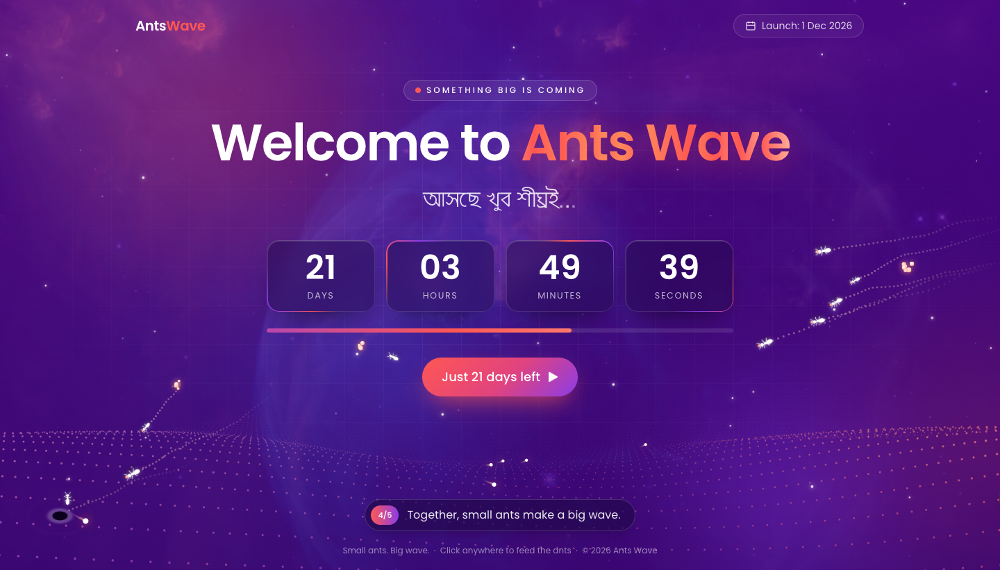

# Ants Wave — Coming Soon

[](https://github.com/antswave/antswave-coming-soon/actions/workflows/deploy.yml)

An animated "Coming Soon" landing page for **Ants Wave**, with a live countdown to launch on **1 December 2026**.

**Live site:** https://antswave.github.io/antswave-coming-soon/



## Features

- Live countdown (days, hours, minutes, seconds) and a progress bar to launch day
- Animated space background with parallax orbs, stars and shooting stars
- A canvas "ant wave": thousands of tiny ants moving together as one wave
- Wandering ants that leave trails and carry food back to their nest
- Click or tap anywhere to drop food for the ants
- Story captions that play through the Ants Wave message
- Bengali tagline (আসছে খুব শীঘ্রই) and a responsive layout for mobile and desktop
- Respects `prefers-reduced-motion`

## Tech stack

- HTML5 and vanilla JavaScript (no build step)
- [Tailwind CSS](https://tailwindcss.com/) via CDN, plus custom CSS in `css/style.css`
- Fonts: Poppins (Google Fonts) and Mukti (Bengali)

## Project structure

```
.
├── index.html                  # Page markup
├── css/style.css               # Custom styles and animations
├── js/script.js                # Countdown, ants, wave canvas and captions
├── images/                     # Image assets
├── screenshots/preview.png     # README screenshot
└── .github/workflows/deploy.yml
```

## Run locally

No install needed. Serve the folder with any static server:

```bash
python3 -m http.server 8000
# then open http://localhost:8000
```

Or just open `index.html` in a browser.

## Deployment

The site deploys to GitHub Pages automatically through GitHub Actions ([`.github/workflows/deploy.yml`](.github/workflows/deploy.yml)):

1. **Check** runs on every push and pull request to `main`:
   - lints HTML with HTMLHint
   - checks JavaScript syntax with `node --check`
   - confirms that every local asset referenced in `index.html` exists
2. **Deploy** runs only after the checks pass, and only on pushes to `main` (pull requests are checked but never deployed).

You can also start a deploy by hand from the **Actions** tab ("Run workflow").

To change the launch date, update the target date in `js/script.js` and the "Launch" label in `index.html`.

## License

© 2026 Ants Wave. All rights reserved.
